# Project Monarch

*Monarch is a temporary project name.*

Monarch keeps track of the software a small or mid-size company already pays for. It does three jobs, equally:

- **What changed.** What's new in the plans and licenses each team already has, with a link to the vendor's own page.
- **Where to save.** Paying twice for the same job, seats nobody uses, billing that costs more than it should, and the date to decide by before each renewal.
- **Features to try.** Features already in the plans you pay for, including AI ones, that could help a process a team already runs.

The home screen is a list of deadlines: what to decide, by when, who decides, and roughly what it's worth in dollars.

**Browse the demo:** [open it in your browser](https://its-lukasz.github.io/project-monarch/). It's a snapshot of the working app with a sample company, Harbor & Pine (120 people, 38 tools). Every page and every tool, saving and feature panel opens; buttons that change data are switched off.

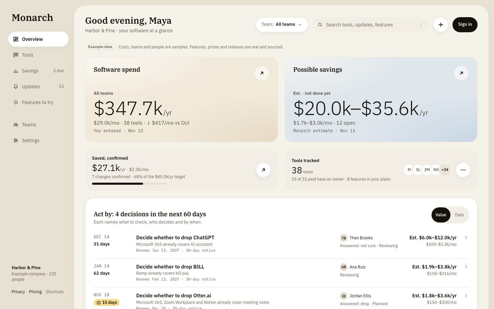

## Always up to date

Monarch keeps collecting release notes and product updates from the vendors behind the tools you use, and checks every week for what's new. Each change is matched to the tools and plans your company has, then shown on the Updates page and in the weekly email for the teams it affects. When a vendor changes a price, a plan or a feature on its own pages, Monarch picks that up too, so what you see stays current without anyone having to go looking.

## Screens

| | |
|---|---|
| 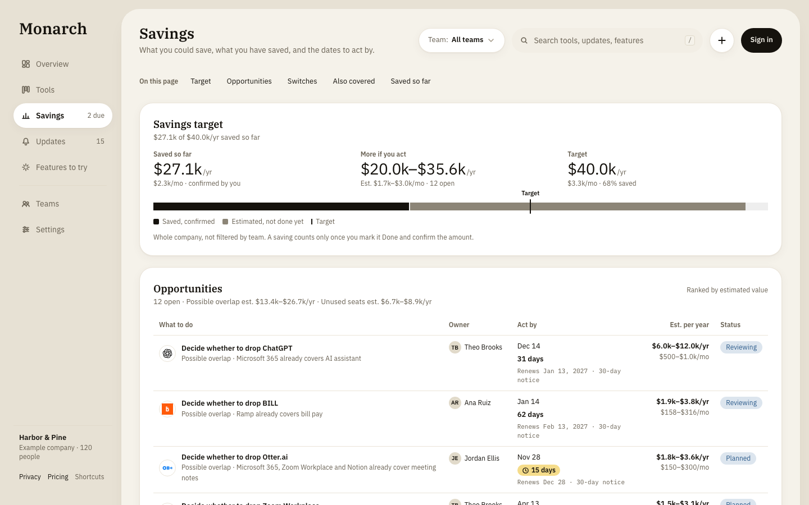 **Savings.** A yearly target, what's been confirmed saved, and every opportunity with an owner, an act-by date and a dollar range. | 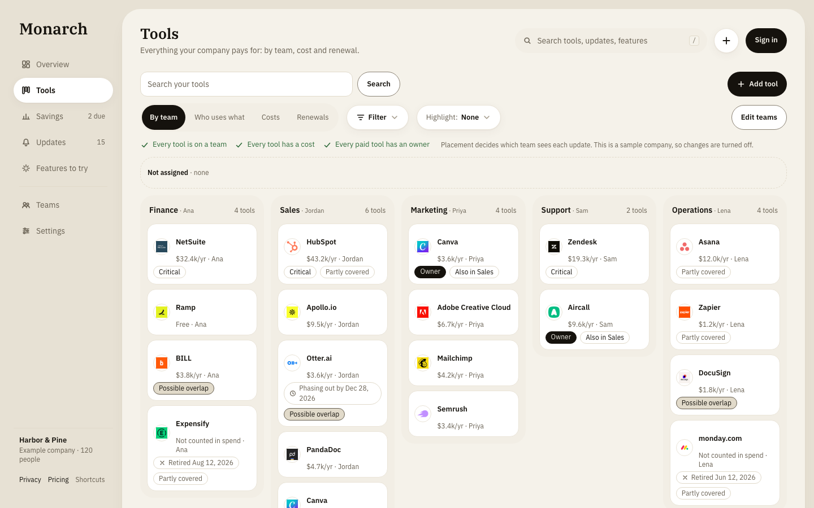 **Tools.** Which team uses which tool, dragged into place. Placement decides who sees each update and how cost is split. |
| 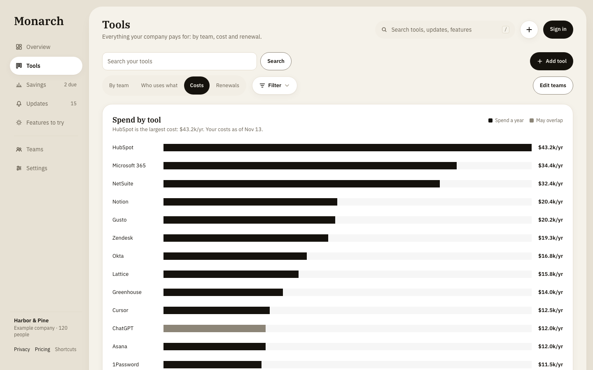 **Costs.** Spend by tool, every figure with its source and date. | 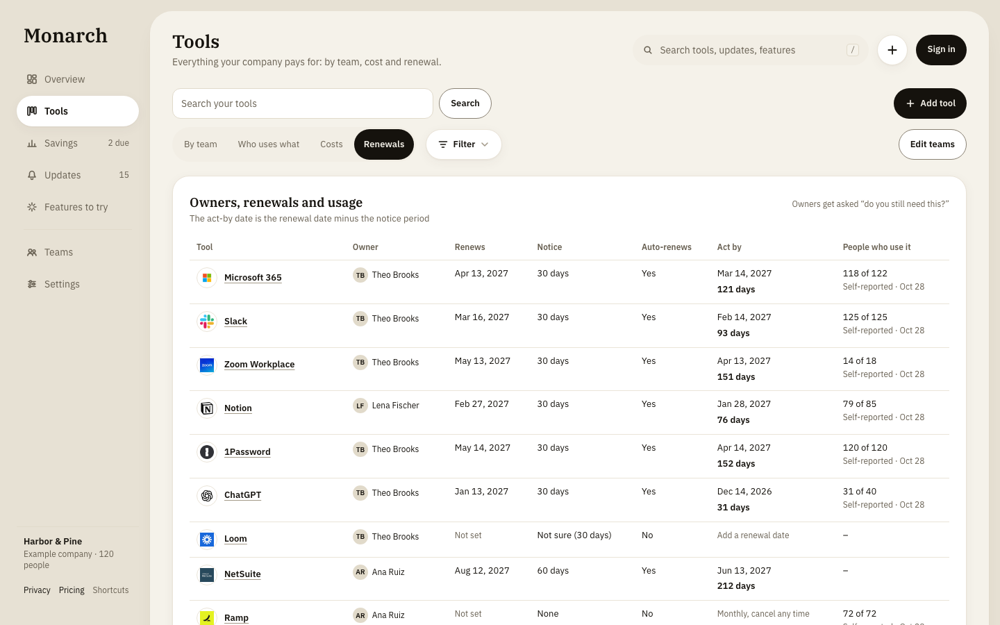 **Renewals.** Owners, renewal dates, notice periods and the date to act by. |
| 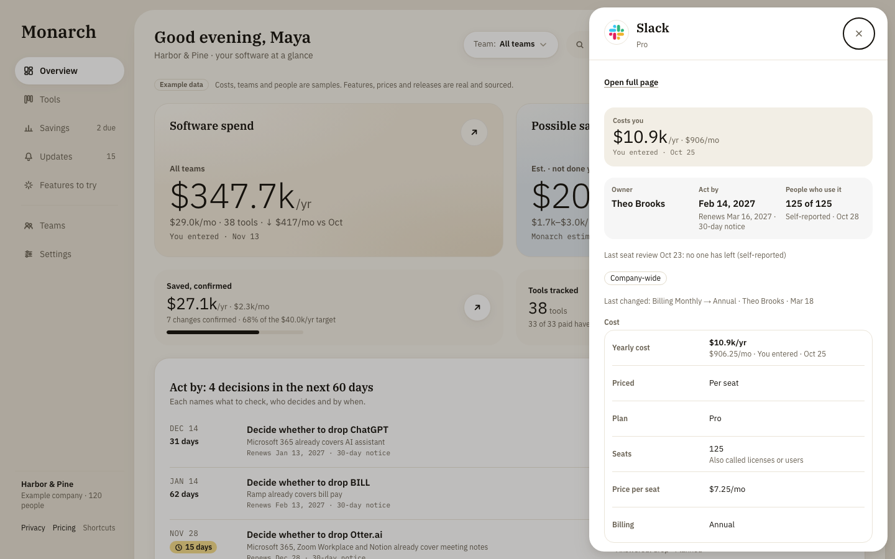 **A tool's panel.** Cost, owner, act-by date, self-reported usage and its history, a click from anywhere. | 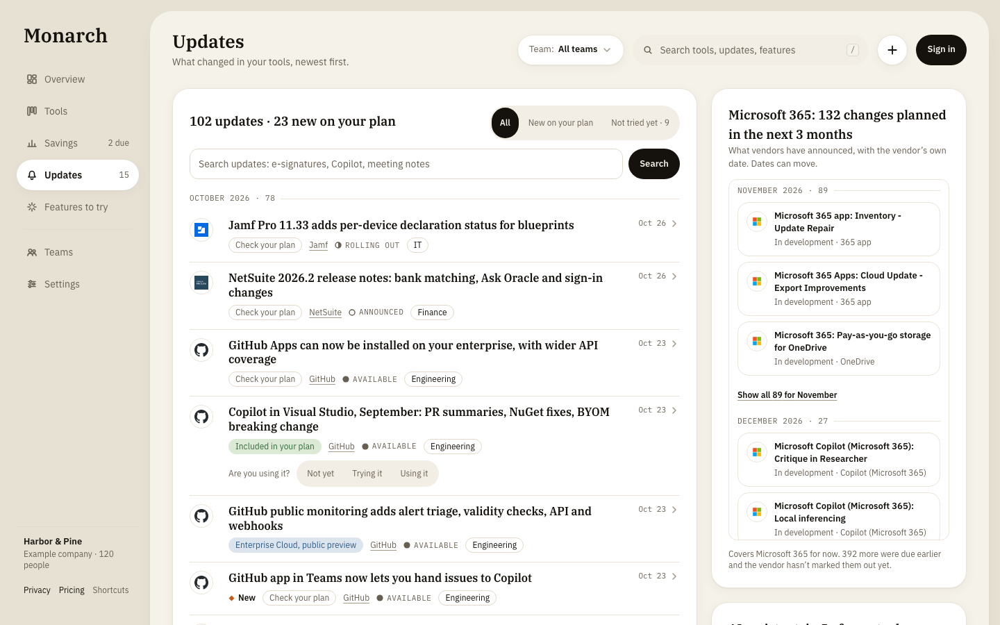 **Updates.** What changed in each tool, sorted by team, newest first. |
| 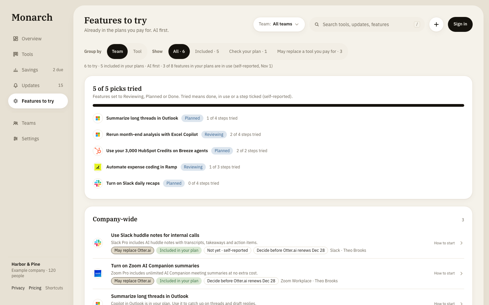 **Features to try.** Already in the plans you pay for, each from the vendor's own pages. | 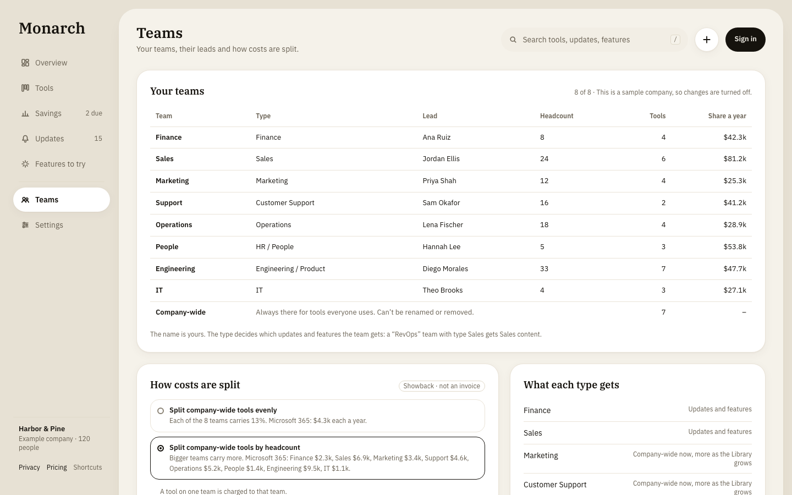 **Teams.** Your own team names, leads, and how shared costs are split (showback, not an invoice). |

### Setup and spreadsheet upload

| | |
|---|---|
| 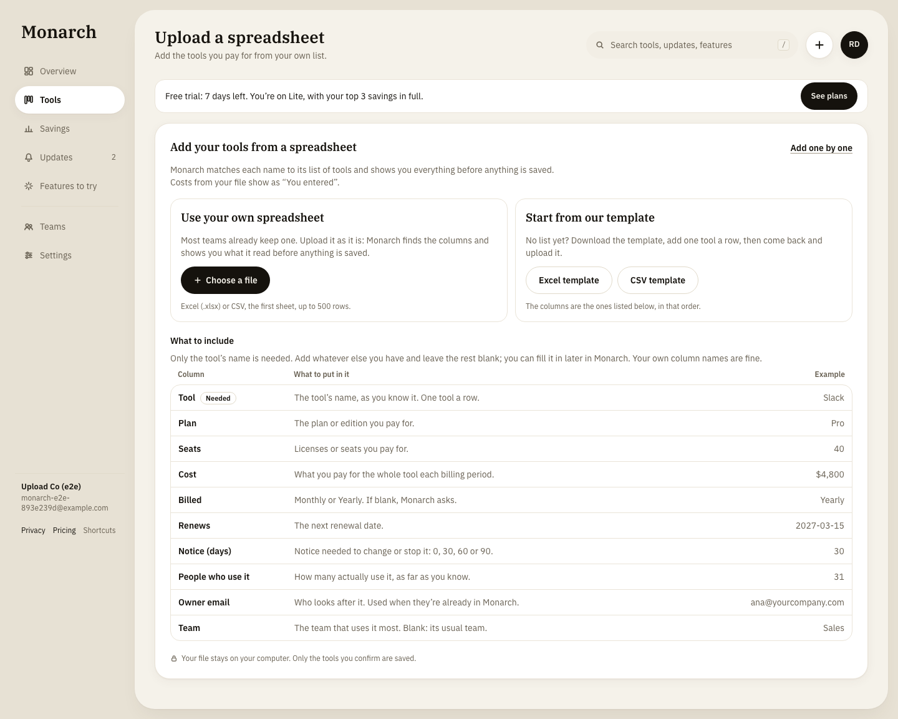 **Use your own spreadsheet or a template.** Only the tool's name is needed. | 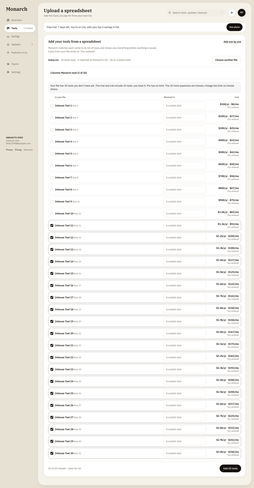 **Every row shown before saving.** Matched to the catalogue, with the cost, its source, and why any cell was left out. Plan limits are applied, most expensive tools first. |
| 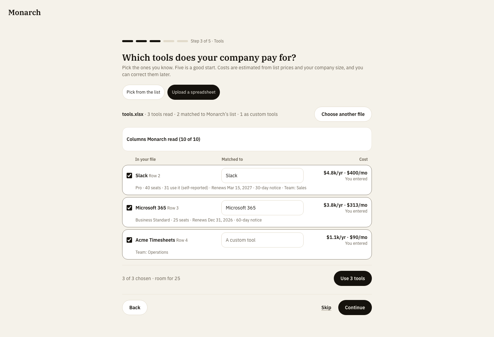 **Setup in about five minutes**, by picking tools or uploading a file. | 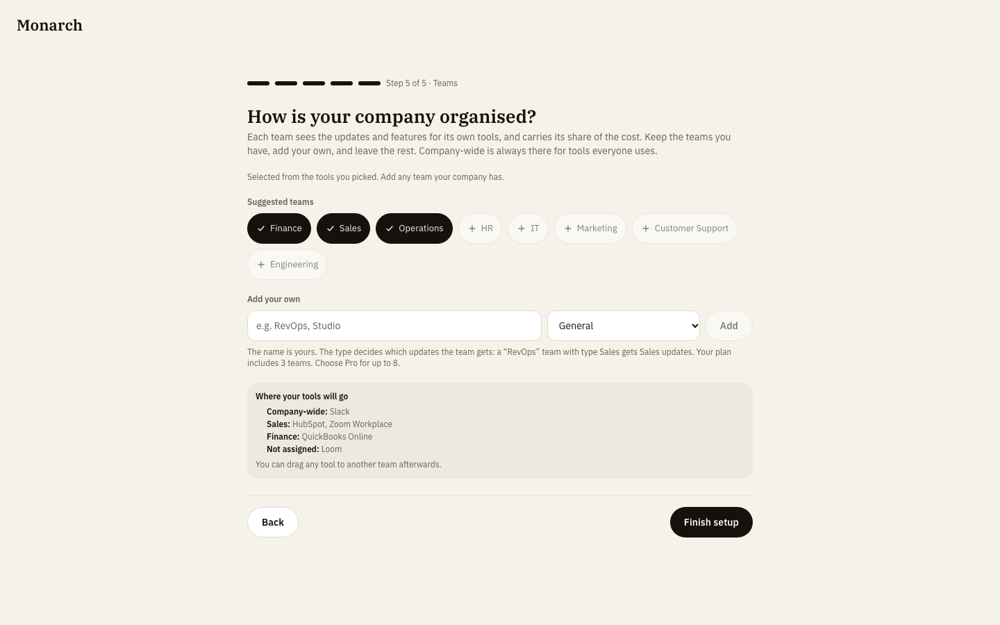 **Teams**, suggested from the tools picked, with a preview of where each tool goes. |

### Email

  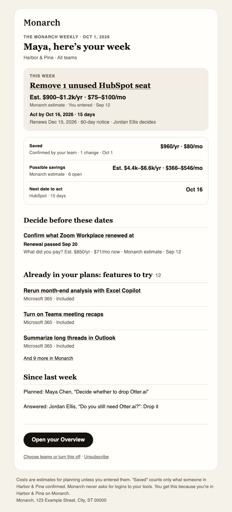
  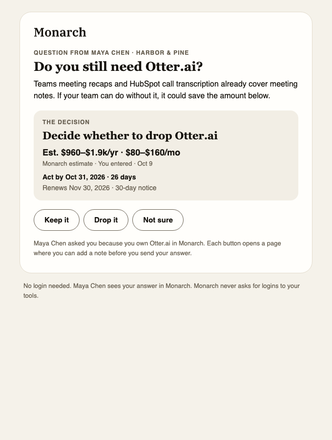

**The Monarch Weekly** arrives Monday 10:30 in each company's own time zone, built from the same calculations, and is checked automatically before sending. **Owner questions** ("Do you still need Otter.ai?") are answered in one click without signing in.

### On a phone

  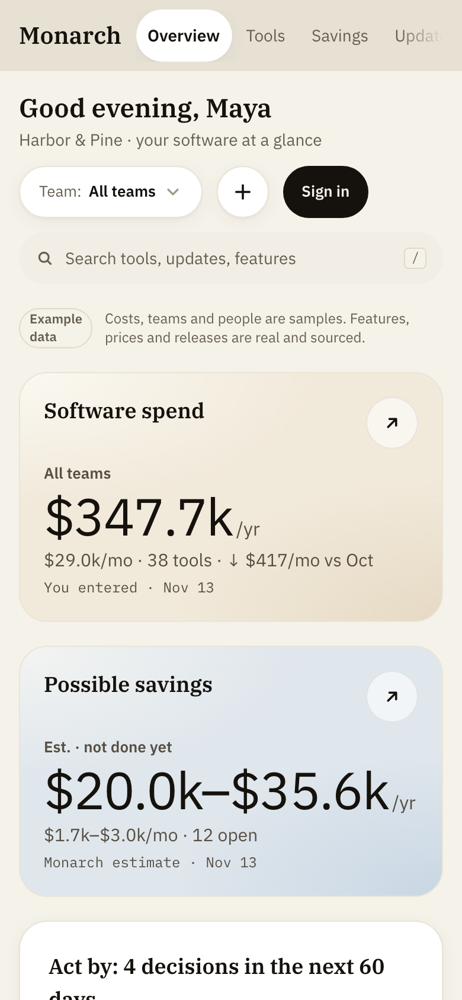
  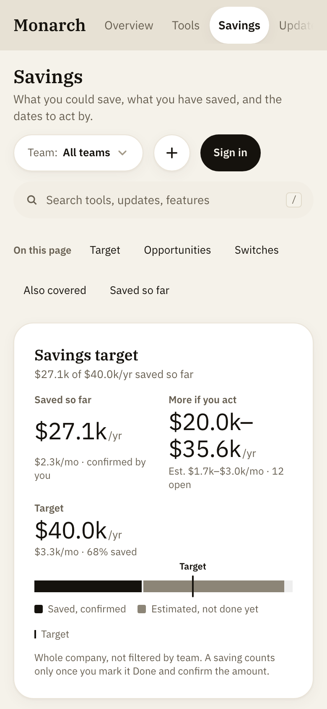

## Rules the product never breaks

- **"Saved" means confirmed.** An estimate always reads like "Est. $960–$1.9k/yr · $80–$160/mo". A saving counts only when a person types the real yearly amount; it is never prefilled.
- **Dollars first**, per year and per month. Percentages only next to dollars. No "up to".
- **A source and a date on every figure:** You entered · List price checked [date] · Estimate · No cost yet.
- **Nothing is invented.** Every feature, price and capability shown comes from a record with a link to the vendor's own page.
- **Never "cancel X".** It says "you may not need X; here's why; check before your renewal."
- **Usage is self-reported** and labelled that way ("34 of 40 seats used (self-reported, Sep 15)").
- **No logins to other tools**, and customer data never trains AI models.

## How it's built

The demo above is a static snapshot. The product itself is a working web app, kept in a private repository:

- **Next.js** (App Router, TypeScript) on **Vercel**; **Supabase** for Postgres and sign-in, with row-level security on every table and a check for every policy.
- **All money logic in one pure, tested module:** savings, cost splits by team, act-by dates (renewal date minus notice period) and totals. No database, no UI, no clock; today's date is passed in.
- **A catalogue of over 1,200 tools**, with plans, list prices and features, each tied to a vendor source.
- **Release notes collected every week** from vendors' own release pages and feeds, reviewed, written up in plain words and matched to each company's tools and teams. Vendor pages behind each record are re-checked, so changes to prices, plans and features are caught.
- **Spreadsheet upload** (Excel or CSV) read in the browser: the file is never uploaded, each row is matched and shown before saving, and an upload only ever adds.
- **Email** with Resend and React Email: the weekly digest, owner questions, invites, seat reviews and trial notices, all in one style with light and dark versions, and one-click unsubscribe.
- **Plans and billing** with Stripe; product analytics with PostHog.
- **Tested:** 340 unit tests and 220 end-to-end browser tests at desktop and phone width, with automated accessibility checks.

## Design

Light, warm and calm: IBM Plex throughout, a linen canvas with white cards, and two soft gradient hero cards (warm for money you pay, cool for estimated savings). Colour means good or bad, never direction, and every status has an icon and a word as well as a colour. Charts are simple bars and lines that start at zero; there are no pies or gauges.

## About this repository

This repository holds the demo snapshot and screenshots. The application code is private. All rights reserved.
